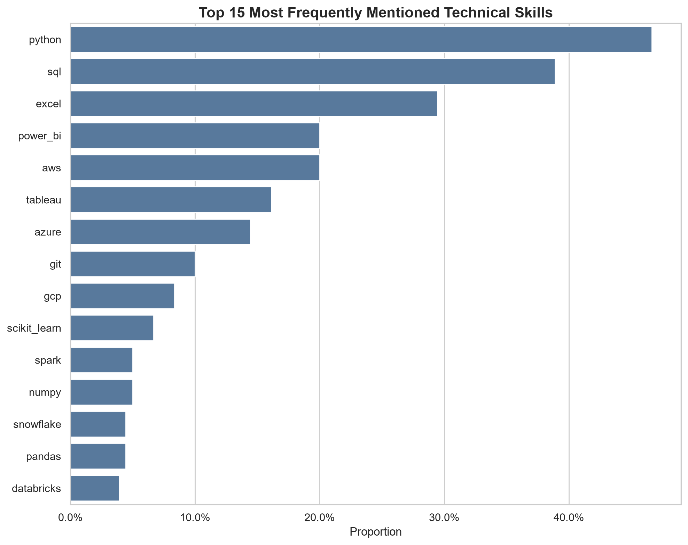
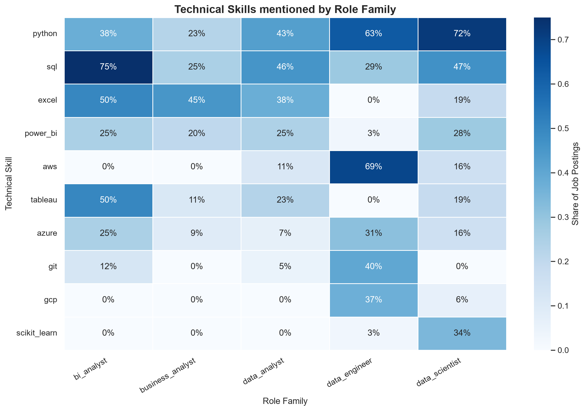
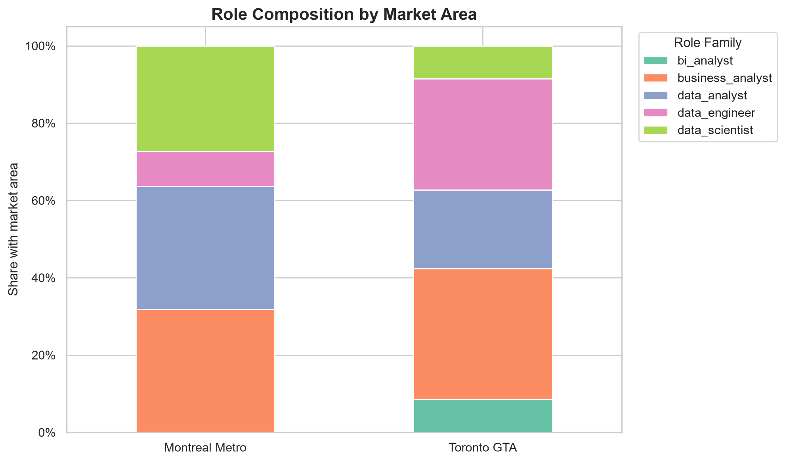

# Canadian Early-Career Data & Analytics Job Market

## Project Overview

This project builds a reproducible data pipeline for analyzing early-career data and analytics job postings in Canada.
Postings are collected through the OpenWebNinja JSearch API, audited, cleaned, deduplicated, classified, and analyzed
using Python and pandas.

The analysis focuses on internship and co-op, new graduate, and entry-level postings across data analyst,
business analyst, BI analyst, data scientist, data engineer, product analyst, operations analyst, and
financial/risk analyst roles. Financial and risk postings share the `financial_risk_analyst` family and retain
`financial_analysis` or `risk_analysis` as a subtype. It explores role composition, technical skill mentions and
combinations, fields of study listed in postings, experience statements, and geographic differences.

**Status:** Data collection, processing, and initial exploratory analysis are complete. Manual classification validation
is pending.

## Research Questions

1. Which technical skills are most frequently mentioned in the collected postings?
2. How do skill mentions differ across role families?
3. Which pairs and groups of three technical skills most commonly co-occur?
4. Which fields of study are explicitly listed, including fields beyond computer science, mathematics, and statistics?
5. How often do postings state numeric experience requirements, and what values does the extraction method capture?
6. How do posting volumes and role composition differ between the Toronto GTA and Montreal Metro?


## Key Findings

The findings below describe the archived 180-posting pre-D1 sample. The fixed replay after D1 now produces 169
analysis candidates under the expanded and revised classifier; the historic figures and charts have not yet been
regenerated for the revised classification.

- **Core technical skills:** Python was detected in 84 postings (46.7%) and
  SQL in 70 postings (38.9%). They formed the most common two-skill
  combination, co-occurring in 54 postings (30.0%).

- **Role-specific skill patterns:** Python and SQL appeared across several
  role families, while BI tools such as Power BI and Tableau were more
  concentrated in analyst-oriented roles. Cloud-platform mentions were more
  common among data engineering and data science postings.

- **Skill combinations:** Python, SQL, and Power BI formed the most common
  three-skill combination, appearing in 21 postings (11.7%). However, no
  single technical-skill bundle appeared in a majority of postings,
  suggesting that employers combine a common analytical foundation with
  role-specific tools.

- **Accepted fields of study:** Computer science was the most frequently
  accepted major among postings that explicitly stated academic fields,
  followed by engineering and data science. Statistics, mathematics,
  business, and other quantitative disciplines were also accepted, indicating
  that employers often consider multiple educational backgrounds rather than
  requiring one specific major.

- **Experience requirements:** Only 29 of 180 postings (16.1%) explicitly stated a
  numeric experience requirement. Because this information was sparsely
  reported, the available values should be treated as a description of the
  observed postings rather than a general estimate of early-career experience
  requirements.

- **Geographic differences:** Data engineering roles accounted for 17 of 59
  Toronto GTA postings (28.8%), compared with 2 of 22 Montreal Metro postings
  (9.1%). The Toronto sample therefore appeared more engineering-oriented,
  although the regional comparison is based on relatively small samples.

Overall, the sample suggests that Python and SQL provide the broadest
technical foundation for early-career data roles, while candidates may need
to add role-specific tools such as Power BI, Tableau, cloud platforms, or
machine-learning libraries depending on their target role family.









## Data Source and Scope

| Measure                          | Current snapshot                                               |
|----------------------------------|----------------------------------------------------------------|
| Source                           | OpenWebNinja JSearch API                                       |
| Geographic scope                 | Canada                                                         |
| Primary markets                  | Toronto GTA, Montreal Metro, and Other Canada                  |
| Archived collection period       | September 11–20, 2026 (UTC; collection timestamps)             |
| Archived raw data                | 643 rows across 4 JSONL batches; 500 unique job IDs            |
| Cleaned and deduplicated records | 492                                                            |
| Analyzed sample (pre-D1 baseline) | 180 postings                                                  |
| Fixed replay after D1            | 169 analysis candidates                                         |
| Posting date range               | August 12–September 16, 2026 (UTC; job publication timestamps) |

Collection timestamps (`collected_at_utc`) and job publication timestamps (`job_posted_at_datetime_utc`) refer to
different events. Search queries are configured for Canada and combine role-related terms with internship, new graduate,
or entry-level terms. Duplicate records are consolidated by job ID.

The classifier now covers eight core role families and three core career levels. The fixed D0 replay preserves the
same four tracked raw batches; its post-D1 analysis count changes because of the revised role rules. The analysis sample
excludes records outside Canada, invalid locations, invalid or future posting dates, postings older than 35 days at
collection, and titles flagged with seniority keywords. Cross-class and senior titles are routed for review, not
included in the formal analysis sample. See [`docs/data_role_review.md`](docs/data_role_review.md) for the real-record
spot-check and underrepresented-class caveats.

Market-area city mappings are maintained in [`config/settings.py`](config/settings.py): Toronto GTA includes Toronto,
Mississauga, and Markham; Montreal Metro includes Montreal, Montreal-Ouest, Greater Montreal, and Mont-Royal.


## Pipeline Architecture

The workflow combines an automated processing pipeline with notebook-based audits and exploratory analysis.
`src/pipeline.py` orchestrates data collection and processing; the notebooks are run separately.

1. **Extraction:** Sends the configured role and career-level queries to JSearch, adds source/query/collection
   metadata, and saves timestamped JSONL batches. The default is one page for each of 24 role-level combinations;
   monthly request accounting, retries, and checkpoints are documented in
   [`docs/data_collection.md`](docs/data_collection.md).
2. **Cleaning:** Standardizes text and timestamps, records missing-ID, invalid-employment-type, and invalid-location
   issues, deduplicates by job ID, normalizes locations, and flags posting age.
3. **Feature engineering:** Classifies role and career level, extracts qualification features, and builds a review
   queue.
4. **Validation:** Checks engineered fields and values, calculates feature coverage, and logs review-label warnings.
5. **Notebook audits and analysis:** `notebooks/01_raw_audit.ipynb` examines raw batches;
   `notebooks/02_cleaning_feature_audit.ipynb` audits cleaning and engineered features;
   `notebooks/03_data_analysis.ipynb` explores role volumes, skill mentions, fields of study, experience statements, and
   regional role composition.

The formal sample is generated from featured records using the role, career-level, country, location, seniority, and
posting-date filters described above. Completed runs update a cumulative JSearch history and create immutable snapshots
under `data/history/`; changes in query coverage alone are not evidence of market growth.

## Feature Engineering

| Feature                   | Description                                                                                              |
|---------------------------|----------------------------------------------------------------------------------------------------------|
| `classified_role_family`  | Role family classified from the job title                                                                |
| `classified_role_subtype` | `financial_analysis` or `risk_analysis` for `financial_risk_analyst`; null for other families              |
| `classified_career_level` | Internship, new graduate, entry-level, unknown, or potential senior; title is checked before description |
| `technical_skills`        | Technical tools and programming skills detected in the posting text                                      |
| `soft_skills`             | Workplace skills detected in the posting text                                                            |
| `accepted_majors`         | Fields of study detected in education-related text; not proof that an employer accepts a field           |
| `language_requirements`   | Languages and bilingual terms detected in the posting text                                               |
| `stated_experience_years` | One numeric value extracted from the posting text                                                        |
| `market_area`             | Toronto GTA, Montreal Metro, or Other Canada, based on normalized location                               |

Extraction uses configured keyword dictionaries and regular expressions; it does not distinguish required skills from
preferred or incidental mentions. Career-level classification checks the title first and uses the description only if no
title match is found. Seniority terms in the title override a career-level match and assign `potential_senior` for
review; a “junior” title and a five-year experience statement can therefore coexist without being reconciled by the
classifier.

Experience extraction stores one value rather than an interval: for a range such as “2–3 years,” it captures the upper
bound (3) as strictest detected threshold; for “3+ years,” it captures 3. If multiple numeric experience statements are found, it keeps the largest
captured value. A recognized no-experience statement takes precedence and is stored as 0. The rule does not distinguish required experience from preferred experience,
alternative qualification paths, or experience requirements attached to different skills.

## Data Quality and Validation

The pipeline removes records without job IDs, deduplicates retained records by job ID, normalizes locations, and records
selected cleaning issues in `data/issues/data_issues.jsonl`. Feature validation raises errors for missing required
feature columns, duplicate IDs, invalid role or career-level categories, invalid list-valued features, and non-numeric
or negative experience values. Allowed but ambiguous labels generate warnings and are included in the review queue.
Manual validation is pending.

Coverage metrics describe the share of records with non-empty extracted features. Passing automated checks confirms
expected structure and values; it does not measure classification accuracy.

## Repository Structure

```text
.
├── config/
│   └── settings.py
├── data/
│   ├── raw/                 # Archived JSONL collection batches
│   ├── processed/           # Latest pipeline-generated outputs
│   ├── issues/              # Latest pipeline-generated cleaning issues
│   └── runs/                # Timestamped snapshots of each pipeline run
├── notebooks/
│   ├── 01_raw_audit.ipynb
│   ├── 02_cleaning_feature_audit.ipynb
│   └── 03_data_analysis.ipynb
├── outputs/
│   ├── figures/
│   └── logs/
├── src/
│   ├── clean.py
│   ├── extract.py
│   ├── feature_engineering.py
│   ├── pipeline.py
│   ├── review.py
│   └── validate.py
├── tests/
│   ├── test_clean.py
│   ├── test_feature_engineering.py
│   └── test_validate.py
├── .env.example
└── requirements.txt
```

The pipeline updates the latest cleaned, featured, analysis, review-queue, search-history, and issue JSONL files under
`data/processed/` and `data/issues/`. It also saves a timestamped copy of each run under `data/runs/`, with processed
files in `processed/` and cleaning issues in `issues/`. Raw collection batches are saved separately under `data/raw/`.

## How to Run

Tested with Python 3.14.0. From the project root, install dependencies:

```powershell
python -m pip install -r requirements.txt
```

To collect fresh data, obtain an API key for the [OpenWebNinja JSearch API](https://www.openwebninja.com/) and add it to
a `.env` file in the project root:

```text
JSEARCH_API_KEY=your_api_key
```

Then run the pipeline:

```powershell
python -m src.pipeline
```

Archived raw batches are included, so the processing pipeline can also run offline without an API key. This example
reads the four in-scope JSONL files and passes the job dictionaries to the same pipeline function:

```python
import json
from pathlib import Path

from src.pipeline import run_pipeline

raw_files = [
    Path("data/raw/jobs_20260911_071658.jsonl"),
    Path("data/raw/jobs_20260920_005742.jsonl"),
    Path("data/raw/jobs_20260920_011920.jsonl"),
    Path("data/raw/jobs_20260920_012618.jsonl"),
]
jobs = [
    json.loads(line)
    for path in raw_files
    for line in path.read_text(encoding="utf-8").splitlines()
    if line.strip()
]

outputs = run_pipeline(jobs, save_raw_batch=False)
print(outputs["analysis_jobs"])
```

This offline run updates the latest processed output files and creates a timestamped archive without creating another
raw batch. The four input paths pin the
archived snapshot used for the dataset counts above, so later API batches are not silently added on reruns. The
posting-age filter uses each record's original `collected_at_utc`, not the offline rerun date, so the same input
snapshot retains the same age reference. If the archived raw files are unavailable in a checkout, collect data through
the API before running the pipeline. The analysis notebooks are available in `notebooks/`; a Jupyter environment is
needed to execute them.

## Testing

Run the project tests from the repository root:

```powershell
python -m pytest
```

Tests cover cleaning, feature engineering, and validation in `tests/`.

## Limitations

Search results depend on the configured queries, API coverage, collection date, and deduplication and filtering rules;
this dataset is not a census of Canadian vacancies. Keyword and regular-expression extraction may miss relevant language
and cannot reliably distinguish required skills from preferred or incidental mentions. A missing extracted skill or
experience value is not evidence that an employer has no such requirement.

Fields of study are detected in education-related text. Not detecting a field—or seeing wording such as “related
field”—does not establish whether an employer accepts or rejects that major. Experience extraction is descriptive and
does not reconcile numeric experience statements with title-based career-level labels.

Posting volumes and role composition do not measure applicant counts or job-seeker competition. Regional comparisons use
normalized market-area labels and should be interpreted cautiously, particularly where the sample is small.

## Future Improvements

- Manually review a stratified sample of the analysis dataset across role families and career levels to assess
  classification precision, and inspect the review queue separately to diagnose ambiguous cases.
- Improve context-aware extraction to distinguish required, preferred, and incidental skill mentions.
- Review conflicting early-career title and experience signals, and retain traceable reasons for analysis inclusion or
  exclusion.
- Expand and rebalance regional collection coverage, then report sample sizes alongside regional comparisons.
- Record reproducible dataset snapshots and analysis outputs for each collection run.

## Technologies

- Python 3.14.0
- pandas and NumPy for data processing
- Requests and python-dotenv for API access and local configuration
- Matplotlib and Seaborn for visualizations
- Jupyter notebooks for audits and exploratory analysis
- pytest for automated tests
